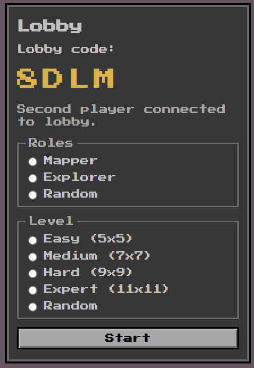
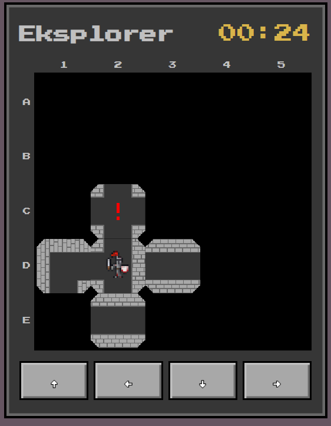
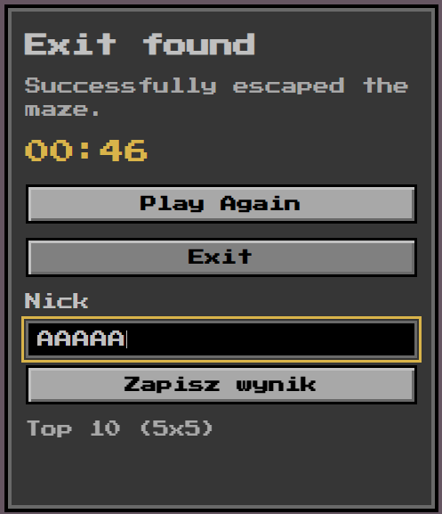

# Find-a-way

## Opis Projektu
 Aplikacja to prosta gra, która polega na przejściu labiryntu.\
 W grze są dwie role.\
 Mapper to osoba z dostępem do mapy. Jej zadaniem jest obracanie kafelków korytarzy i przykazywanie kierunków do wyjścia drugiej osobie.\
 Eksplorer to osoba poruszająca się rycerzem. Niestety jako postać uwięziona w labiryncie masz ograniczony widok, pozwala jednak wykryć pułapki na drodze.

## Instalacja 

 * Do uruchomienia programu na localhoście
 ```
    npm run dev
 ```

 * Potrzebne instalacje do uruchomienia
 ```
 npm install
 npm install peerjs     
 npm install @supabase/supabase-js    
 ```

## Przykłady użycia
### Połączenie
* Widok lobby z perspektywy hosta.\
 
* Widok lobby z perspektywy osoby dołączającej.
Aby połączyć się z drugą osobą, osoba hostująca przekazuje kod pokoju drugiej osobie. Gdy druga osoba dołączy, host dostaje taką informacje.


### Widok Explorera
 \
Jako eksplorer widzisz jedynie bloki wokół siebie. Czerwony wykrzyknik to pułapka, wejście w nią kończy się przegraną.
Do poruszania można użyć strzałek, lub klawiszy literowych wsad. Jednak przy rozszerzonych typach zalecane jest użycie liter qweasdzc, jako że pozwala to dodatkowo przechodzenie po przekątnych. 

### Zmiana klawiszy ruchu
 \
Aby zmienić preferowane klawisze literowe do przejścia labirynu należy kliknąć przycisk "Klawisze". Pojawi się wtedy lista klawiszy. Aby zmienić wybrany klawisz ruchu trzeba kliknąć odpowiadającą mu obecnie litere, a następnie kliknąć preferowaną z klawiatury.

### Widok Mappera
 \
Jako mapper widzisz całą mapę i aktualne ustawienie bloczków. Aby obrócić wybrany bloczek należy na niego kliknąć. Miejsce kliknięcia na bloczek ma znaczenie, klikając w prawą połowe obracasz w prawo, lewą strone w lewo. Żółta strzałka to wyjście do którego prowadzisz drugą osobe.

## Licencja

MIT

Copyright <YEAR 2026> <COPYRIGHT HOLDER  Mateusz Miś oraz Wiktor Malec>

Permission is hereby granted, free of charge, to any person obtaining a copy of this software and associated documentation files (the “Software”), to deal in the Software without restriction, including without limitation the rights to use, copy, modify, merge, publish, distribute, sublicense, and/or sell copies of the Software, and to permit persons to whom the Software is furnished to do so, subject to the following conditions:

The above copyright notice and this permission notice shall be included in all copies or substantial portions of the Software.

THE SOFTWARE IS PROVIDED “AS IS”, WITHOUT WARRANTY OF ANY KIND, EXPRESS OR IMPLIED, INCLUDING BUT NOT LIMITED TO THE WARRANTIES OF MERCHANTABILITY, FITNESS FOR A PARTICULAR PURPOSE AND NONINFRINGEMENT. IN NO EVENT SHALL THE AUTHORS OR COPYRIGHT HOLDERS BE LIABLE FOR ANY CLAIM, DAMAGES OR OTHER LIABILITY, WHETHER IN AN ACTION OF CONTRACT, TORT OR OTHERWISE, ARISING FROM, OUT OF OR IN CONNECTION WITH THE SOFTWARE OR THE USE OR OTHER DEALINGS IN THE SOFTWARE.
