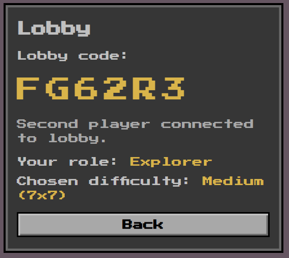
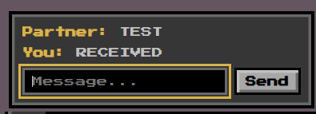
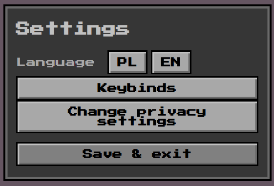
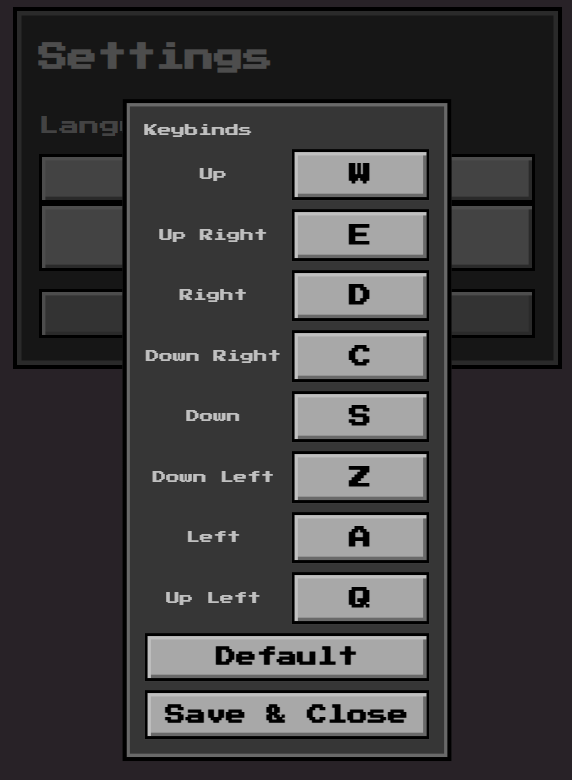

# Find-a-way

## Polski
## Opis Projektu
 Aplikacja to prosta gra, która polega na przejściu labiryntu.\
 W grze są dwie role.\
 Mapper to osoba z dostępem do mapy. Jej zadaniem jest obracanie kafelków korytarzy i przykazywanie kierunków do wyjścia drugiej osobie.\
 Eksplorer to osoba poruszająca się rycerzem. Niestety jako postać uwięziona w labiryncie masz ograniczony widok, pozwala jednak wykryć pułapki na drodze.

## Instalacja 

 * Do uruchomienia programu na localhoście
 ```
    npm run dev
 ```

 * Potrzebne instalacje do uruchomienia
 ```
 npm install
 npm install peerjs     
 npm install @supabase/supabase-js    
 ```

 ## Baza danych
 Dodana na potrzebę spełnienia wymagania projektu studenckiego. \
 Klucz „anonimowy” usługi Supabase w tym repozytorium jest z założenia publiczny. \
 Przechowywane w środku są jedynie podane przez użytkowników nazwy oraz czas przejścia, więc nie ma obaw do utracenia ważnych danych. \
 Dostęp jest ograniczony za pomocą mechanizmu Row Level Security (dostępne są tylko operacje wstawiania/odczytu). 

## Przykłady użycia
### Połączenie
* Widok lobby z perspektywy hosta.\
 \
Osoba hostująca ma możliwość wyboru ról oraz poziomu trudności.

* Widok lobby z perspektywy osoby dołączającej.
 \
Osoba, która dołączyła widzi jedynie swoją role i wybrany poziom trudności.


Aby połączyć się z drugą osobą, osoba hostująca przekazuje kod pokoju drugiej osobie. Gdy druga osoba dołączy, host dostaje taką informacje - "Second player connected to lobby.".


### Widok Explorera
 \
Jako eksplorer widzisz jedynie bloki wokół siebie. Czerwony wykrzyknik to pułapka, wejście w nią kończy się przegraną.
Do poruszania można użyć strzałek, lub klawiszy literowych wsad. Jednak przy rozszerzonych typach zalecane jest użycie liter qweasdzc, jako że pozwala to dodatkowo przechodzenie po przekątnych. 

### Widok Mappera
 \
Jako mapper widzisz całą mapę i aktualne ustawienie bloczków. Aby obrócić wybrany bloczek należy na niego kliknąć. Miejsce kliknięcia na bloczek ma znaczenie, klikając w prawą połowe obracasz w prawo, lewą strone w lewo. Żółta strzałka to wyjście do którego prowadzisz drugą osobe.

### Chat
 \
Gracze mają możliwość komunikacji między sobą. Czat ma ograniczoną historie do 10 wiadomości oraz 50 liter na jedną wiadomość.

### Tipy
(IN PROGRESS)

### Ustawienia
 \
Pod klawiszem 'ESC' lub klikając w ikone zębatki użytkownik jest przekierowywany do ustawień. Tam jest możliwość doboru języka, przypisania klawiszy ruchu oraz zmiany zgody do połączenia z serwerem.

### Zmiana klawiszy ruchu
 \
Aby zmienić preferowane klawisze literowe do przejścia labirynu należy kliknąć przycisk "Klawisze". Pojawi się wtedy lista klawiszy. Aby zmienić wybrany klawisz ruchu trzeba kliknąć odpowiadającą mu obecnie litere, a następnie kliknąć preferowaną z klawiatury.


## English

## Project Description
The application is a simple game in which players must navigate through a maze. \
There are two roles in the game: \
Mapper – a player who has access to the entire map. Their task is to rotate corridor tiles and communicate directions to the other player to help them reach the exit. \
Explorer – a player who navigates the maze as a knight. Unfortunately, as a character trapped inside the maze, you have a limited field of view. However, you can still detect traps along your path.

## Installation

 * To run the application locally:
 ```
    npm run dev
 ```

 * Required dependencies:
 ```
 npm install
 npm install peerjs     
 npm install @supabase/supabase-js    
 ```

 ## Database
The database was added to meet the requirements of a student project. \
The Supabase "anon" key included in this repository is intentionally public. \
The database only stores usernames provided by users and their completion times, so there is no risk of losing any important data. \
Access is restricted using Row Level Security (RLS). Only INSERT and SELECT operations are allowed.

## Usage Examples
### Connection
* Lobby view from the host's perspective. \
 \
The host can choose the roles and difficulty level.

* Lobby view from the perspective of a joining player.
 \
The joining player can only see their assigned role and the selected difficulty level.


To connect with another player, the host must share the room code with them. Once the second player joins, the host receives the following notification: "Second player connected to lobby."


### Explorer View
 \
As an Explorer, you can only see the tiles surrounding your character. The red exclamation mark indicates a trap. Stepping on one results in losing the game. You can use the arrow keys or the WASD keys to move. However, when using extended movement options, the QWEASDZC keys are recommended, as they also allow diagonal movement.

### Mapper View
 \
As a Mapper, you can see the entire map and the current tile arrangements. To rotate a tile, simply click on it. The position of the click matters: Clicking the right half of a tile rotates it clockwise. Clicking the left half rotates it counterclockwise. The yellow arrow indicates the exit you must guide the other player towards.

### Chat
 \
Players can communicate with each other using the built-in chat.
The chat has the following limitations: 
* Message history is limited to 10 messages. 
* Each message can contain up to 50 characters.

### Tips
(IN PROGRESS)

### Settings
 \
Pressing the ESC key or clicking the gear icon opens the settings menu.
There, users can:
* Change the application language.
* Customize movement key bindings.
* Change their consent settings for connecting to the server.

### Changing Movement Key Bindings
 \
To change your preferred movement keys, click the "Keys" button. A list of available key bindings will appear.
To change a specific movement key, click its currently assigned key and then press the desired key on your keyboard.

## Licencja / License

MIT

Copyright 2026 Mateusz Miś, Wiktor Malec

Permission is hereby granted, free of charge, to any person obtaining a copy of this software and associated documentation files (the “Software”), to deal in the Software without restriction, including without limitation the rights to use, copy, modify, merge, publish, distribute, sublicense, and/or sell copies of the Software, and to permit persons to whom the Software is furnished to do so, subject to the following conditions:

The above copyright notice and this permission notice shall be included in all copies or substantial portions of the Software.

THE SOFTWARE IS PROVIDED “AS IS”, WITHOUT WARRANTY OF ANY KIND, EXPRESS OR IMPLIED, INCLUDING BUT NOT LIMITED TO THE WARRANTIES OF MERCHANTABILITY, FITNESS FOR A PARTICULAR PURPOSE AND NONINFRINGEMENT. IN NO EVENT SHALL THE AUTHORS OR COPYRIGHT HOLDERS BE LIABLE FOR ANY CLAIM, DAMAGES OR OTHER LIABILITY, WHETHER IN AN ACTION OF CONTRACT, TORT OR OTHERWISE, ARISING FROM, OUT OF OR IN CONNECTION WITH THE SOFTWARE OR THE USE OR OTHER DEALINGS IN THE SOFTWARE.
